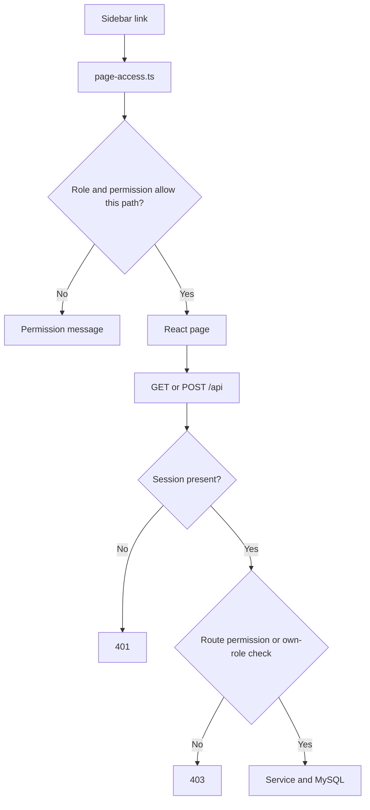
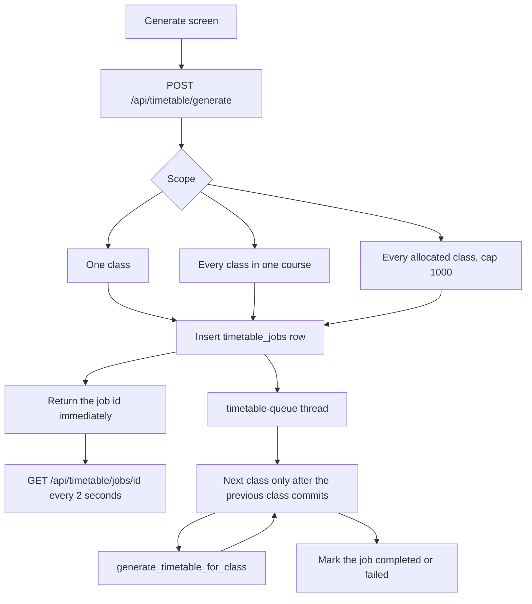
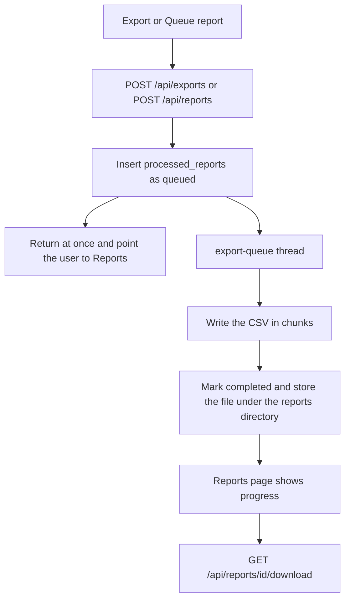

# System flows

These are the paths the running application takes. The browser never waits inside the request while a large timetable or a large export is built.

## Sign-in

```mermaid
flowchart TD
  open[Open the site] --> session[GET /api/session]
  session --> who{Signed in?}
  who -->|No, path is / or /login| student[Student and teacher form]
  who -->|No, path starts with /admin| adminForm[Admin form]
  who -->|Yes, student or teacher| portal[Portal home]
  who -->|Yes, staff| adminHome[/admin dashboard]
  student --> postStudent[POST /login]
  adminForm --> postAdmin[POST /admin/login]
  postStudent --> roleCheck{Role is Student or Teacher?}
  postAdmin --> staffCheck{Role is Admin, Super Admin, or HOD?}
  roleCheck -->|Yes| portal
  roleCheck -->|No| student
  staffCheck -->|Yes| adminHome
  staffCheck -->|No| adminForm
```

A student or teacher password is checked only against those roles. An admin password is checked only against Admin, Super Admin, and HOD. A failed sign-in is recorded as a failed login. A successful sign-in stores the account in the Flask session and writes a `user_sessions` row.

## Opening a page



The page check and the API check are separate. Hiding a menu item does not replace the API permission check.

## Invitation and registration

1. A staff account with permission to change users creates an invitation.
2. The invitation row stores a token, an expiry, and a status of pending.
3. The public page `/register/<token>` calls `GET /api/register/<token>`.
4. The preview says the link is open, already used, expired, or invalid. It does not return the email address or the token.
5. An open invitation can capture a face photo and submit `POST /register/<token>`.
6. A successful registration marks the invitation used. A pending invitation whose expiry is in the past is shown as expired.

## Timetable generation



Only one generation job is queued or running at a time. A second request attaches to that job instead of starting another one. Classes run one after another so a faculty member or a room is not booked twice. The worker is a daemon thread in the Flask process, not a separate queue service.

## Exports and reports



The download is allowed only when the job is completed, the file stays inside the reports storage directory, and the caller may export reports or is the person who queued that job and still has the source permission. The list response does not include the file path.

## Attendance

Staff with the attendance permissions open `/admin/attendance` and the records, faculty, and mobile-log pages. Those pages call `/api/attendance/...`.

A teacher opens `/my-attendance`, marks a lecture, and reviews its history. Those calls use the signed-in faculty identity, so a teacher writes attendance only for their own lecture. A student opens `/my-attendance` and sees their own subject totals.

Mobile attendance sync stays on `/mobile-sync/v1` and does not use the browser session.

## Startup work

On the first request, Flask checks that MySQL answers. Outside the test run it then starts a background pass that adds any missing composite indexes. Existing indexes are left in place. The timetable and export workers start when the first job of that kind is queued.
